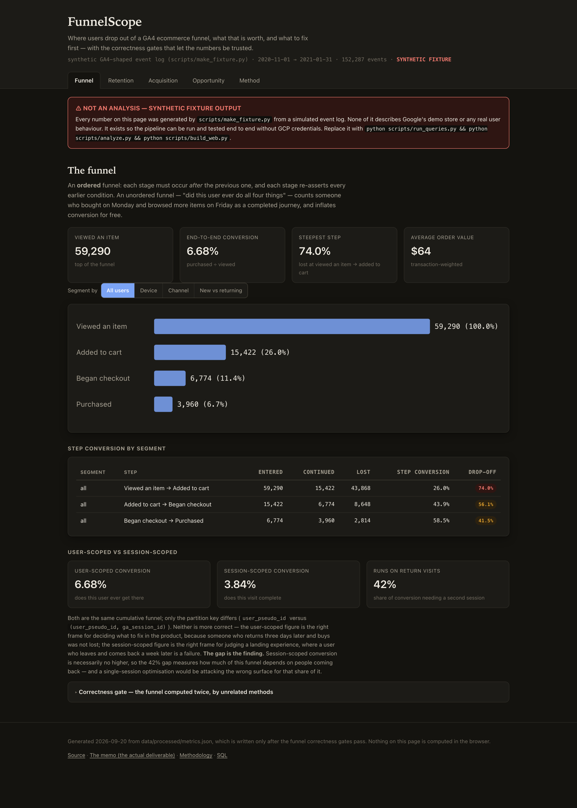
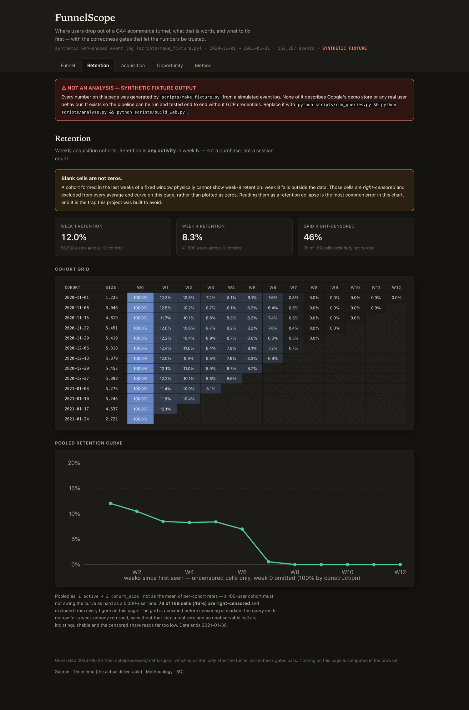
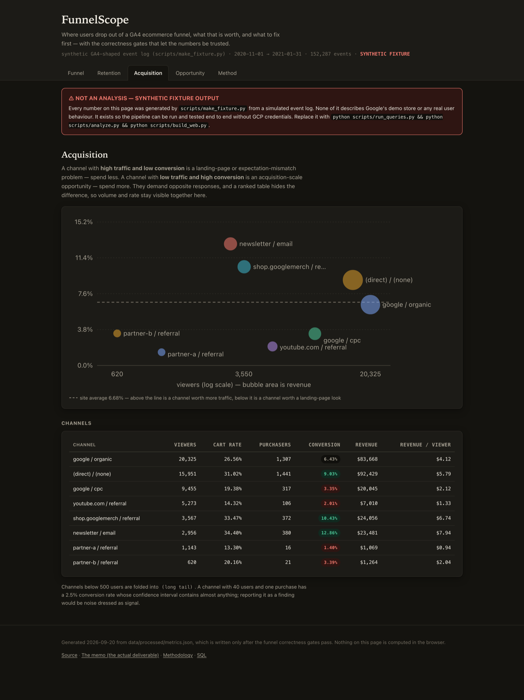
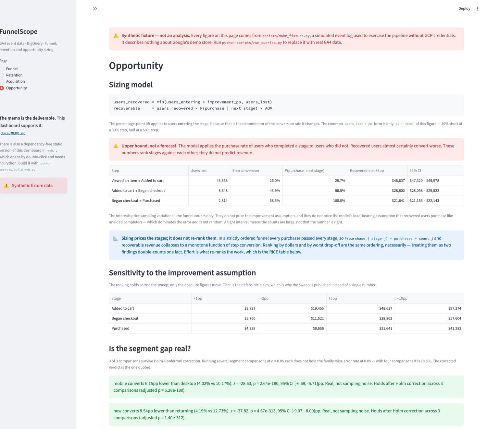

# FunnelScope

**Product analysis of raw GA4 event data: an ordered conversion funnel, cohort retention,
opportunity sizing, and a RICE-prioritised recommendation memo.**

`BigQuery SQL` · `Python 3.12` · `Streamlit` · `pytest`

> **The deliverable is [`docs/MEMO.md`](docs/MEMO.md).** The dashboards support it.
> Read the memo first; the SQL is where the work is.

---

## What this is, honestly

This analyses **Google's public obfuscated GA4 sample export** —
`bigquery-public-data.ga4_obfuscated_sample_ecommerce`, 1 Nov 2020 to 31 Jan 2021. It is
a demo dataset, not a business problem I uncovered, and the repo does not pretend
otherwise. What is real is the analysis: SQL written against GA4's genuinely nested event
schema, an ordered funnel that survives being computed two independent ways, significance
testing corrected for multiple comparisons, and a memo that says what it would do and
what it cannot know.

I built it because a portfolio full of *systems I built* had nothing in it that was
*analysis I performed on real event data*, which is the core competency for product- and
business-analyst work. That is the gap it fills, and that is the whole claim.

---

## Quick start

### macOS / Linux

```bash
git clone https://github.com/IshaanS0112/FunnelScope.git
cd FunnelScope
bash setup.sh
```

### Windows (PowerShell)

```powershell
git clone https://github.com/IshaanS0112/FunnelScope.git
cd FunnelScope
.\setup.ps1
```

If PowerShell refuses to run the script, its execution policy is blocking local files:
`Set-ExecutionPolicy -Scope Process -ExecutionPolicy Bypass`, then re-run.

Both scripts create a **Python 3.12** virtual environment, install the dependencies, and
build the synthetic fixture so every artifact has something to render immediately. Python
is pinned to 3.12 because some dependencies still have no 3.13 wheels on Windows, and a
setup script that only works on one machine is a defect.

### Then

```bash
open web/index.html                      # static site — no server, no Python
streamlit run app/streamlit_app.py       # local analyst dashboard
pytest -q                                # full test suite
```

---

## What it looks like

<p align="center">
  
</p>

The static site's **Funnel** page. Every figure is stamped with its provenance — the banner
at the top is derived from the same manifest the numbers are, so fixture output cannot
render as a clean analysis.

<p align="center">
  
</p>

**Retention.** The hatched cells are right-censored — a cohort formed in the last weeks of
the window physically cannot show week-8 retention, so those cells are excluded from every
average rather than plotted as zeros. The staircase shape is the window closing, not users
leaving.

<p align="center">
  
</p>

**Acquisition.** Volume and rate together, because they separate two problems that a ranked
table blurs: high traffic with low conversion is a landing-page problem (spend less), low
traffic with high conversion is a scale opportunity (spend more).

<p align="center">
  
</p>

The Streamlit dashboard's **Opportunity** page — sizing with bootstrap intervals, the
sensitivity sweep, and Holm-corrected significance verdicts.
[More screenshots](docs/screenshots/).

---

## Two front ends, for two different readers

**[`web/`](web/) — a static site.** Plain HTML, CSS and JavaScript: no framework, no build
step, no npm, no CDN. It opens by double-click from a `file://` URL and deploys to GitHub
Pages by pushing. That matters because the person most likely to open this project will
not clone it, and a dashboard that needs `pip install` first is a dashboard they will not
see. `scripts/build_web.py` writes `web/data.js` from `metrics.json`; the page computes
nothing of its own.

**[`app/streamlit_app.py`](app/streamlit_app.py) — the local dashboard.** Faster to extend
while the analysis is being worked out, and it has the filtering an analyst wants. It
needs Python running, which is why it is not the thing on the CV.

Both read the same `metrics.json` and import the same `funnelscope/` package, so they
cannot disagree with each other or with the memo.

---

## Regenerating everything from BigQuery

```bash
pip install google-cloud-bigquery db-dtypes
gcloud auth application-default login
export GOOGLE_CLOUD_PROJECT=your-sandbox-project-id

python scripts/run_queries.py --dry-run   # cost estimate, nothing billed
python scripts/run_queries.py             # export sql/ results to data/processed/
python scripts/analyze.py                 # gates, sizing, z-tests, RICE -> metrics.json
python scripts/render_memo.py             # metrics.json -> docs/MEMO.md
python scripts/build_web.py               # metrics.json -> web/data.js
```

Or `make all`, which runs the last three in order.

BigQuery Sandbox is free, needs no billing account, and gives 1 TiB/month. A full refresh
here is ≈ 4.9 GB — roughly 200 free re-runs a month. Per-query costs are logged in
[`docs/QUERY_COSTS.md`](docs/QUERY_COSTS.md).

---

## Architecture, and why it looks like this

```
sql/*.sql                    versioned queries, parameterised, documented
   │  scripts/run_queries.py
   ▼
data/processed/*.csv         committed  ──►  _manifest.json records provenance
   │  scripts/analyze.py     ── correctness gates run FIRST ──
   ▼
data/processed/metrics.json  every number quoted anywhere
   ├─► scripts/render_memo.py ──► docs/MEMO.md
   ├─► scripts/build_web.py   ──► web/ static site
   └─► app/streamlit_app.py   ──► local dashboard
```

**Two BigQuery Sandbox constraints shaped this:** tables and views expire after 60 days,
and DML is blocked. So nothing is persisted server-side; the repo persists *results*.

The consequence is the good part. Because the front ends read exported data rather than
querying BigQuery live, anyone can run them — a recruiter, an interviewer, you. A
live-query dashboard would run for exactly one person and would be dead in 60 days.

---

## The parts worth looking at

**`sql/02_funnel_ordered.sql` — cumulative ordering predicates.**
Each funnel stage re-asserts every earlier condition. The obvious independent form
(`COUNTIF(checkout_ts > cart_ts)` on its own) lets the funnel go non-monotonic: a user can
satisfy `checkout > cart` without ever satisfying `cart > view`, and then a later stage
exceeds an earlier one. It raises no error — it just quietly produces a better-looking
number. Explained in the file, enforced by `funnelscope.funnel.check_monotonic`, and
grepped for by a test.

**`sql/02b_funnel_validation.sql` — the same funnel, computed a second way.**
Events are collapsed into an ordered string and matched with a sequence regex. It shares
no logic with the timestamp method. The pipeline **refuses to emit metrics** if the two
disagree by more than 0.5%, so a memo cannot be produced from a funnel that failed
validation.

**`sql/09_funnel_session_scoped.sql` — the same funnel, scoped to the visit.**
Session-scoped conversion is necessarily no higher than user-scoped conversion, and the
gap between them measures how much of the funnel runs on people coming back. A large gap
means a single-session optimisation is attacking the wrong surface.

**`funnelscope/sizing.py` — a correction and a proof.**
The standard formula `users_lost × improvement_pp × …` uses the wrong denominator: a
percentage-point lift applies to the conversion *rate*, whose denominator is users
entering. The `users_lost` form is only `(1 − rate)` of the correct figure — 30% short at
a 30% step — and correcting it means multiplying by `1/(1 − rate)`, 1.43× at a 30% step.
More interestingly, the frequent claim that *"the biggest recoverable revenue is rarely
the worst drop-off stage, and that gap is the finding"* is **impossible** in a strictly
ordered funnel: recoverable revenue reduces to a monotone function of step conversion, so
the two rankings are identical by construction. Proved in the module docstring, asserted
over random funnels in the test suite, and stated in the memo instead of a finding that
cannot exist.

**`funnelscope/retention.py` — right-censoring, and the bug underneath it.**
A cohort formed in the last weeks of a fixed window cannot show later-week retention, so
those cells are tagged and excluded rather than plotted as zeros. The subtler part: the
retention query emits **no row at all** for a week nobody returned, which makes a real
zero and an unobservable cell indistinguishable — and censoring can only be marked on rows
that exist. `densify()` expands the grid to the full cohort × week rectangle first.
Without it the censored share is computed over observed cells only and can read as exactly
0% while appearing to work.

**`funnelscope/stats.py` — Holm–Bonferroni.**
Several segment comparisons at α = 0.05 each do not hold the family-wise error rate at
0.05; with four comparisons it is 18.5%. Both raw and adjusted p-values are reported and
the corrected verdict is the one the memo quotes.

**`funnelscope/io.py` — provenance you cannot bypass.**
Every write stamps `data/processed/_manifest.json` with `bigquery` or
`synthetic-fixture`. The memo renderer, both dashboards and the notebook read that stamp
and label themselves. Fixture numbers physically cannot render as a clean analysis, and a
test asserts the linkage in both directions.

---

## Repository layout

```
sql/            10 documented queries + a README with per-query scan costs
funnelscope/    funnel maths, censoring, sizing, z-tests, Holm, RICE
                (one implementation, shared by everything downstream)
scripts/        run_queries · make_fixture · analyze · render_memo · build_web
data/processed/ committed CSVs + _manifest.json + metrics.json
notebooks/      analysis.ipynb — exploration; imports funnelscope, re-implements nothing
web/            static site — index.html · styles.css · app.js · data.js (generated)
app/            streamlit_app.py — Funnel · Retention · Acquisition · Opportunity
docs/           MEMO.md (the deliverable) · MEMO_TEMPLATE.md · methodology.md
                QUERY_COSTS.md · INTERVIEW.md
tests/          invariants, SQL static checks, full pipeline, both front ends
```

## Tests

```bash
pytest                    # unit + SQL static checks + dashboard smoke tests
pytest -m slow            # full fixture -> analyze -> memo -> site chain
```

The SQL cannot be executed without GCP, so it is checked for what is statically knowable
and expensive when wrong: a missing `_TABLE_SUFFIX` filter, a `SELECT *`, any DDL/DML,
missing header documentation, and — for the funnel queries specifically — stage predicates
that are not cumulative. `sqlglot` parses every file against the BigQuery dialect.

Beyond that: funnel invariants, retention censoring and densification, the sizing model
including the random-funnel equivalence property, the z-test against SciPy, Holm against
statsmodels, the re-export diff, and smoke tests that click through every page of both
front ends.

## Without a GCP account

```bash
python scripts/make_fixture.py   # simulated GA4-shaped event log
python scripts/analyze.py
python scripts/render_memo.py
python scripts/build_web.py
```

This exercises the whole pipeline with no credentials. It is a **fixture, not an
analysis**: the fixture simulates a per-user event log and aggregates it twice by both
funnel methods, so the cross-validation gate is genuinely exercised rather than trivially
satisfied. The manifest records it as synthetic, and every artifact it produces carries a
banner saying so.

## Licence

MIT — see [LICENSE](LICENSE).
