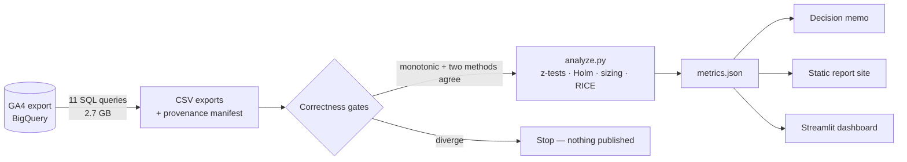

<p align="center">
  
</p>

# FunnelScope

**Where shoppers leave a GA4 ecommerce funnel, what that is worth, and what to fix first.**
A product-analytics case study on 4.3 million raw events, written as a decision memo rather than a dashboard.

[](https://ishaans0112.github.io/FunnelScope/)
[](https://github.com/IshaanS0112/FunnelScope/actions/workflows/ci.yml)


**[Read the memo →](docs/MEMO.md)** · [Live report](https://ishaans0112.github.io/FunnelScope/) · [Methodology](docs/methodology.md) · [Interview defence](docs/INTERVIEW.md)

---

## Results snapshot

| | |
|---|---|
| **Data** | 4,295,584 GA4 events · Google Merchandise Store · Nov 2020 – Jan 2021 |
| **Funnel** | 61,252 viewers → 11,114 carts → 4,167 checkouts → **2,356 purchases (3.85%)** |
| **Biggest leak** | **81.9%** of viewers never add to cart — 85% of every shopper the funnel loses |
| **Real segment gap** | Returning shoppers convert at **1.8×** new ones (6.40% vs 3.60%, adjusted p = 2e-24) |
| **Not a finding** | Desktop vs mobile: 3.77% vs 3.95%, **p = 0.27 — noise**, so no mobile project |
| **Largest prize** | Up to **$41k** from a 5-point lift in add-to-cart (upper bound) |
| **Recommendation** | Rework the product-page add-to-cart path — scores **4.8×** the next option on RICE |

## Business question → decision

Each chapter of the report answers one question a product team would actually ask, and ends in a decision rather than a chart.

| # | Business question | What the data says | Decision |
|---|---|---|---|
| 01 | Where do shoppers leave? | 81.9% drop before cart; later steps keep 37% and 57% | Fix the product page before checkout |
| 02 | Is the loss concentrated in a segment? | New vs returning is real; device is noise | Don't fund a mobile-specific fix |
| 03 | Which channels bring buyers? | Conversion spans 3.6% – 5.7%; volume and quality diverge | Rebalance spend — after checking LTV |
| 04 | Do shoppers come back? | 4.3% return in week one, yet 22% of purchases need a return visit | Persist the cart across sessions |
| 05 | What is each fix worth? | $41k / $20k / $13k ceilings by step | Size steps as ceilings, never forecasts |
| 06 | What do we do first? | Product page leads RICE 23,398 to 4,861 | Ship it behind an A/B test |
| 07 | Why trust any of this? | Funnel computed two independent ways — agree to zero | Pipeline refuses to publish if they diverge |

## How it works



**The gate is the part worth reading.** The funnel is computed twice — once by comparing timestamps, once by regex over each shopper's event sequence. On the first real export they disagreed by 17%, and neither query had a bug: GA4 users repeat steps constantly, and GA4 stamps every event in one request with the same microsecond. Both are now handled, the methods agree exactly, and if they ever drift by more than 0.5% the pipeline stops. Full story in [methodology.md](docs/methodology.md).

<table>
  <tr>
    <td width="50%"></td>
    <td width="50%"></td>
  </tr>
  <tr>
    <td><sub>Segment gaps with 95% intervals — device crosses zero, so it isn't written up as a finding.</sub></td>
    <td><sub>Cohort retention. Hatched cells are not yet observable, not zero — excluded from every average.</sub></td>
  </tr>
</table>

## What's in the repo

| Folder | What it holds |
|---|---|
| [`sql/`](sql/) | 11 parameterised BigQuery queries — funnel, validation, segments, cohorts, revenue |
| [`funnelscope/`](funnelscope/) | The only place maths happens: funnel gates, z-tests, Holm, sizing, censoring, RICE |
| [`scripts/`](scripts/) | The pipeline: export → analyse → render memo → build site |
| [`docs/`](docs/) | **[MEMO.md](docs/MEMO.md)** (the deliverable), methodology, interview defence, query costs |
| [`web/`](web/) | The report site — plain HTML/CSS/JS, opens from `file://`, deploys to GitHub Pages |
| [`app/`](app/) | Streamlit dashboard for interactive filtering |
| [`tests/`](tests/) | 159 tests: SQL static checks, funnel invariants, statistics vs SciPy/statsmodels |

## Run it

```bash
git clone https://github.com/IshaanS0112/FunnelScope.git && cd FunnelScope
bash setup.sh                      # Windows: .\setup.ps1
open web/index.html                # the report — no server needed
```

`streamlit run app/streamlit_app.py` for the dashboard · `pytest` for the tests · `make all` to rebuild everything. Re-exporting from BigQuery needs a free Sandbox project — see [sql/README.md](sql/README.md).

## Scope, honestly

This is Google's public obfuscated GA4 sample, not a business problem I found — channel and product names are redacted at source. What is real is the analysis: SQL against GA4's nested schema, a funnel that survives two independent implementations, statistics corrected for multiple comparisons, and recommendations that state their assumptions. Every revenue figure is an upper bound, and nothing here has been A/B tested.

---

<sub>MIT licence · Built by Ishaan Singh</sub>
