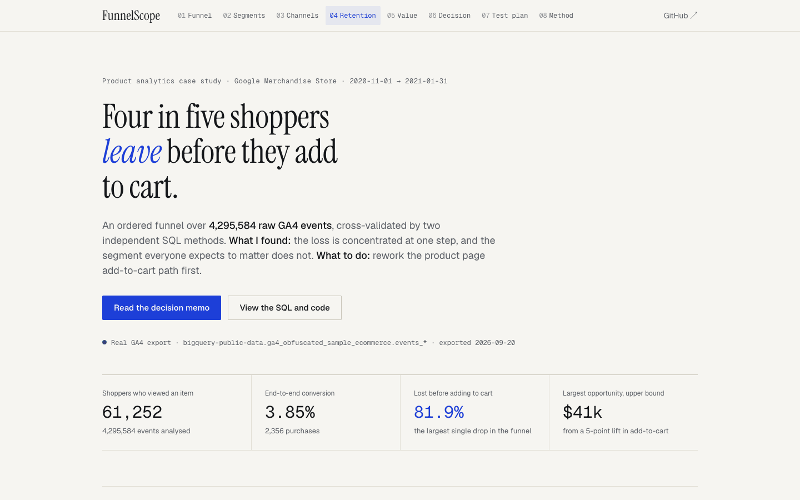
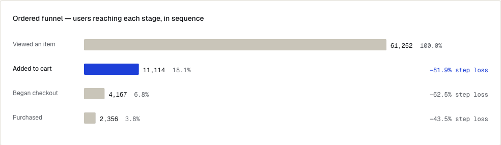
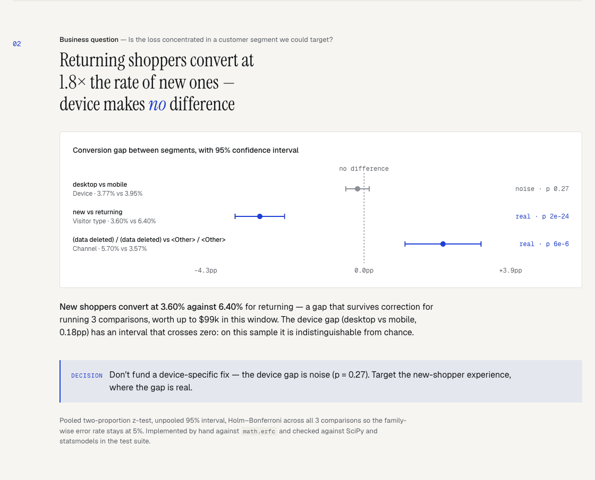
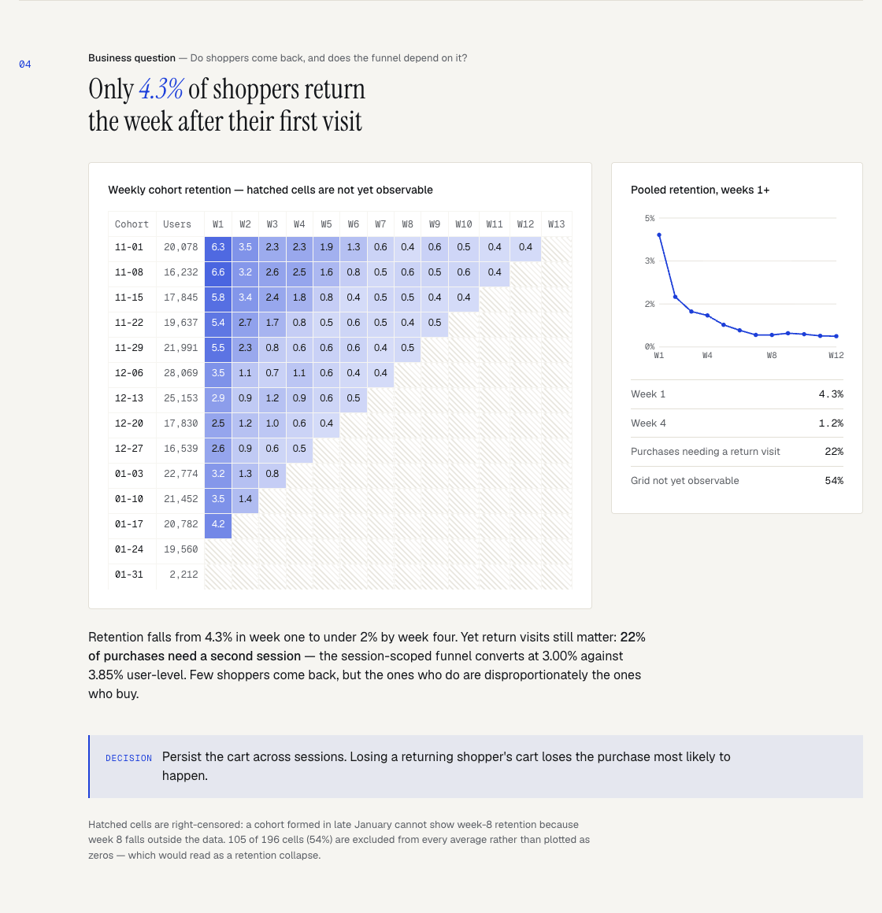
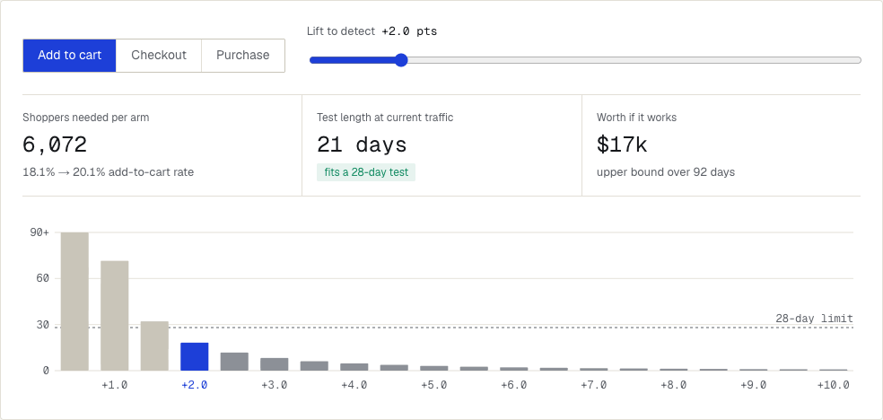
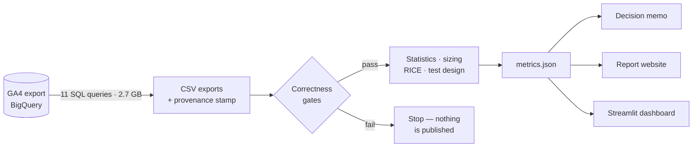

<p align="center">
  
</p>

# FunnelScope

**Where shoppers leave a GA4 ecommerce funnel, what that is worth, and what to fix first.**

A product-analytics case study on 4.3 million raw Google Analytics 4 events, queried in
BigQuery and delivered as a decision memo — every finding ends in a recommendation, and
every recommendation ends in a test plan.

[](https://ishaans0112.github.io/FunnelScope/)
[](https://github.com/IshaanS0112/FunnelScope/actions/workflows/ci.yml)


**[Live report](https://ishaans0112.github.io/FunnelScope/)** · [Decision memo](docs/MEMO.md) · [Methodology](docs/methodology.md) · [Interview defence sheet](docs/INTERVIEW.md)

---

## The answer in 30 seconds

| | |
|---|---|
| **Data** | 4,295,584 GA4 events · Google Merchandise Store · 1 Nov 2020 – 31 Jan 2021 |
| **Funnel** | 61,252 viewers → 11,114 carts → 4,167 checkouts → **2,356 purchases (3.85%)** |
| **Biggest leak** | **81.9%** of viewers never add to cart — 85% of every shopper the funnel loses |
| **Real segment gap** | Returning shoppers convert at **1.8×** new ones (6.40% vs 3.60%, adjusted p = 2e-24) |
| **Not a finding** | Desktop vs mobile: 3.77% vs 3.95%, **p = 0.27** — noise, so no mobile project |
| **Largest prize** | Up to **$41k** from a 5-point lift in add-to-cart (upper bound) |
| **What to do first** | Rework the product-page add-to-cart path — scores **4.8×** the next option on RICE |
| **How to prove it** | 3-week 50/50 test; detects a **+2-point** lift with 6,072 shoppers per arm |

---

## The analysis, step by step

Each step answers one question a product team would ask, and ends in a decision.

### 1 · Where do shoppers leave?



The funnel is **ordered**: each step must happen after the one before, and each stage
re-checks every earlier condition — otherwise the query silently reports more checkouts than
carts. **81.9% of viewers never add to cart**, while the later steps keep 37% and 57%.
→ **Fix the product page before checkout.**

### 2 · Is the loss concentrated in a segment?



Every segment gap is tested with a two-proportion z-test and corrected for running several
comparisons (Holm–Bonferroni). Returning shoppers really do convert better. The device gap
**crosses zero** — it is noise, despite 60,000 users.
→ **Don't fund a mobile-specific fix; target first-time shoppers.**

### 3 · Do shoppers come back?



Only 4.3% return the following week, yet **22% of purchases need a second visit**. Hatched
cells are **right-censored** — a January cohort cannot show week-8 retention because week 8
is outside the data — so they are excluded rather than read as a collapse.
→ **Keep the cart across sessions.**

### 4 · What should we do first — and how do we prove it?



Opportunity sizing turns each step into a dollar ceiling; RICE (Reach × Impact × Confidence ÷
Effort) ranks the fixes. Then the pipeline **designs the A/B test**: sample size from the
measured baseline, duration from real traffic, and guardrails that must not fall. It found
that **only the add-to-cart fix is testable at this traffic** — checkout steps see 121 and 45
shoppers a day, too few to detect anything under 5 and 8 points in a month.
→ **Run a 3-week test on the product page; ship only if the guardrails hold.**

---

## How it works



1. **Extract** — parameterised BigQuery SQL against GA4's nested event schema. A full refresh
   scans 2.7 GB, well inside the free tier.
2. **Validate** — the funnel is computed twice, by two unrelated methods. If they disagree by
   more than 0.5%, the pipeline stops. On the first real export they disagreed by 17%: GA4
   users repeat steps, and GA4 stamps events sent together with the same microsecond. Both are
   now handled and the methods agree exactly.
3. **Analyse** — significance tests, retention with censoring, opportunity sizing with
   confidence intervals, RICE, and A/B test design.
4. **Publish** — one `metrics.json` feeds the memo, the website and the dashboard, so they can
   never disagree.

---

## Repository layout

| Folder | What it holds |
|---|---|
| [`sql/`](sql/) | 11 BigQuery queries: funnel, validation, segments, cohorts, revenue |
| [`funnelscope/`](funnelscope/) | All the maths: funnel gates, statistics, sizing, retention, RICE, test design |
| [`scripts/`](scripts/) | The pipeline: export → analyse → render memo → build site |
| [`docs/`](docs/) | [Decision memo](docs/MEMO.md), [methodology](docs/methodology.md), [interview defence](docs/INTERVIEW.md), query costs |
| [`web/`](web/) | The report website — plain HTML/CSS/JS, no build step |
| [`app/`](app/) | Streamlit dashboard |
| [`tests/`](tests/) | 175 tests, including statistics checked against SciPy and statsmodels |

## Run it

```bash
git clone https://github.com/IshaanS0112/FunnelScope.git && cd FunnelScope
bash setup.sh                       # Windows: .\setup.ps1
open web/index.html                 # the report — no server needed
```

`streamlit run app/streamlit_app.py` opens the dashboard · `pytest` runs the tests ·
`make all` rebuilds everything. Re-exporting from BigQuery needs a free Sandbox project — see
[sql/README.md](sql/README.md).

## Built with

BigQuery SQL · Python 3.12 · pandas · NumPy · Streamlit · Altair · pytest · GitHub Actions ·
GitHub Pages · plain HTML/CSS/JavaScript

## Scope

This is Google's public, obfuscated GA4 sample — channel and product names are redacted at
source. The business is Google's; the analysis is mine. Every revenue figure is an upper
bound, and the recommendations are hypotheses until the test plan is run.

---

<sub>MIT licence · Ishaan Singh</sub>
